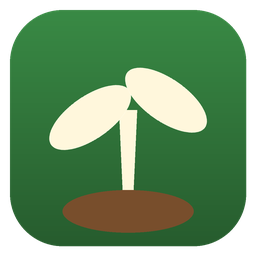
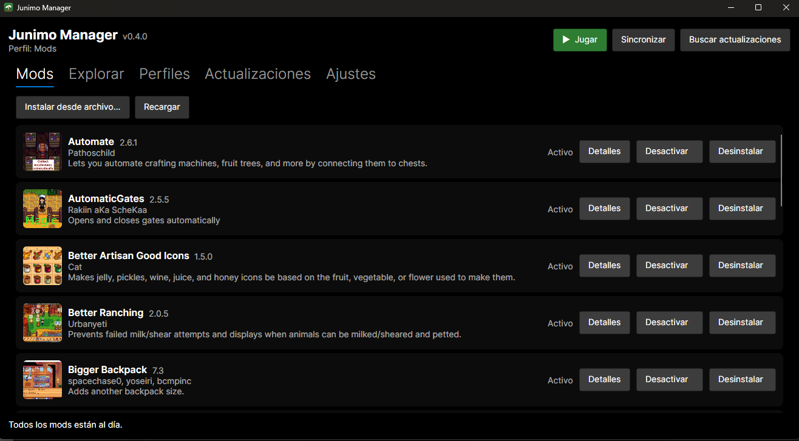
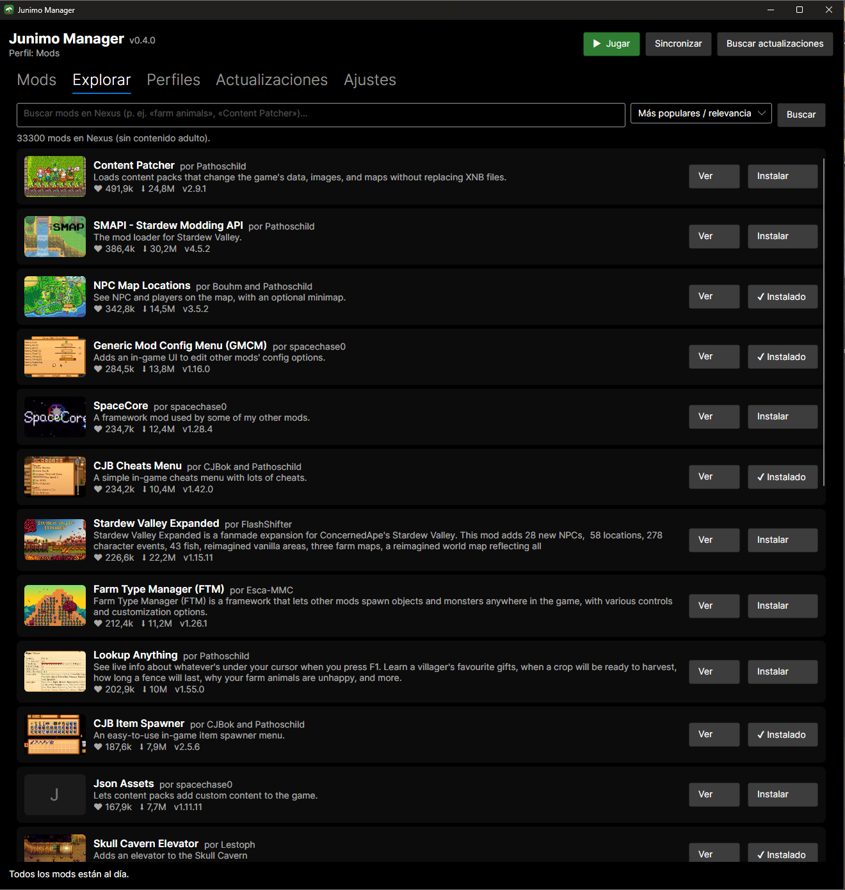
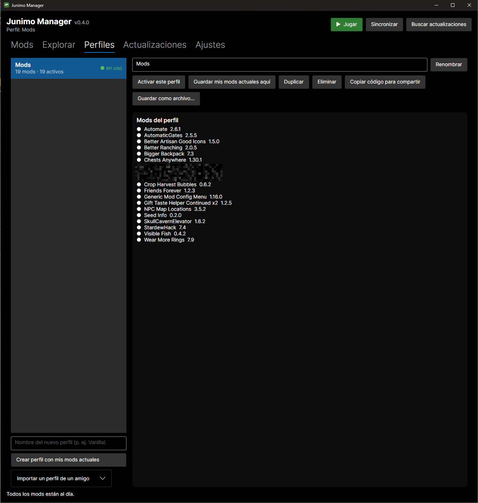
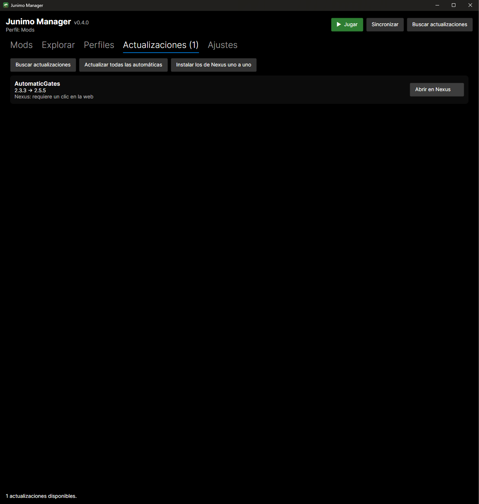
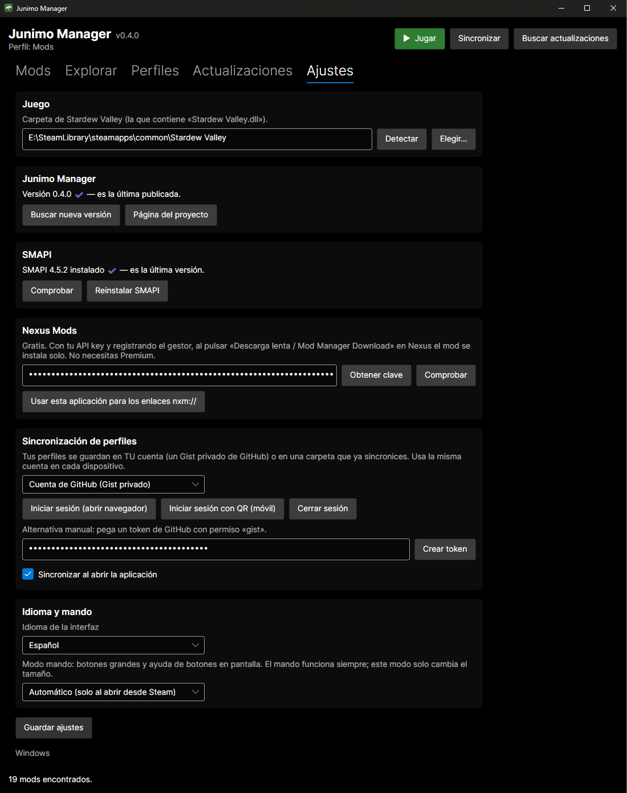

[](https://github.com/FranLopezZ/Junimo-Manager/releases)
[](https://github.com/FranLopezZ/Junimo-Manager/releases)

#  Junimo Manager
Hecho con ❤ desde Almería, España
#

Gestor gratuito de mods de **Stardew Valley** para **Windows** y **Linux** (incluida la **Steam Deck**). Instala, actualiza y organiza mods con perfiles, y sincroniza tu configuración entre dispositivos. Sin suscripciones. Aplicación nativa multiplataforma hecha con .NET y Avalonia.

## Características
- **Detección automática del juego** en Steam, incluida la tarjeta SD de la Steam Deck. Botón **Jugar** que lanza el juego con SMAPI.
- **Instalador de SMAPI**: si falta, descarga el paquete oficial y abre su instalador en una terminal (en Linux/Deck deja a Steam lanzando SMAPI automáticamente).
- **Instalación de mods** desde `.zip`, `.7z` y `.rar`: admite packs con varios mods, conserva `config.json` y el estado activado/desactivado al actualizar, y guarda una copia de la versión anterior.
- **Dependencias**: avisa de las que faltan o están desactivadas.
- **Actualizaciones gratuitas**
  - Versiones consultadas vía smapi.io.
  - Descarga automática si el mod publica en GitHub Releases.
  - Mods solo en Nexus: se abre la página y, tras pulsar «Descarga lenta / Mod Manager Download», la instalación se completa mediante enlaces `nxm://` con una API key gratuita de Nexus (no hace falta Premium).
- **Explorar mods**: busca en el catálogo de Nexus (sin API key), con miniaturas y ficha de cada mod (descripción, imágenes de la descripción, descargas, categorías).
- **Perfiles** (p. ej. «Vanilla», «Supervivencia») que activan o desactivan mods renombrando su carpeta con el prefijo `.`, que SMAPI ignora.
- **Compartir perfiles**: exporta un perfil como archivo `.junimo` o como un código de texto para pegar en un mensaje; tus amigos lo importan y, al activarlo, se instalan los mods que les falten.
- **Sincronización de perfiles** entre dispositivos mediante un **Gist privado de GitHub** (cuenta propia de cada usuario) o una carpeta compartida.
- **Actualización automática**: la versión se ve junto al título y, si hay una nueva en GitHub, un botón «Actualizar ahora» la descarga, la instala y reinicia la app. También comprueba SMAPI.
- **Idiomas**: español e inglés (automático según el sistema, o a elegir en Ajustes).
- **Mando**: se maneja con mando (Steam Deck en modo juego, o cualquier mando Xbox en Windows): cruceta/stick para moverse, A seleccionar, B atrás, LB/RB cambiar de pestaña, X buscar actualizaciones, Y sincronizar, Start jugar. Si se abre desde Steam, usa botones grandes y muestra la ayuda de botones.
- **Inicio de sesión con GitHub** mediante device flow (navegador o QR para el móvil), o pegando un token con permiso `gist`.
- **Claves cifradas** en disco: DPAPI en Windows; en Linux, archivo con permisos 600.

## Imagenes







## Instalación

### Windows [Portable]
Descarga `JunimoManager-<versión>-win-x64.zip` desde [Releases](https://github.com/FranLopezZ/Junimo-Manager/releases), extráelo y ejecuta `JunimoManager.exe`.

### Linux y Steam Deck
1. Descarga `JunimoManager-<versión>-linux-x64.zip` (x64, válido para cualquier distribución moderna y para la Deck) y extráelo.
2. Abre una terminal en la carpeta extraída y ejecuta:
   ```
   bash install.sh
   ```
   Crea el acceso en el menú y en el escritorio y registra el manejador `nxm://`.
3. Para usarlo en modo juego, añádelo a Steam como juego no-Steam.

Es un único paquete x86_64 autónomo (incluye .NET): vale para SteamOS y para cualquier distribución de 64 bits con entorno gráfico (Ubuntu, Fedora, Arch, openSUSE…). No necesita instalar nada más.

## Datos
Ajustes y perfiles: `%APPDATA%\JunimoManager` (Windows) o `~/.config/JunimoManager` (Linux). Copias de seguridad de mods: `JunimoManager-Backups` dentro de la carpeta del juego.

## Limitaciones conocidas
- Mods solo alojados en Nexus: un clic por mod en la web (restricción de Nexus para cuentas gratuitas).
- Idiomas: español e inglés por ahora (¿quieres otro? se añade con un archivo de traducción).
- El mando es nuevo y está pendiente de probar en una Deck real; si el teclado en pantalla no aparece al pulsar A en un cuadro de texto, usa el de Steam (Steam + X).
- Probado en Windows; la versión Linux está en fase de pruebas.

Junimo Manager es un proyecto de la comunidad, sin relación con ConcernedApe, SMAPI.
